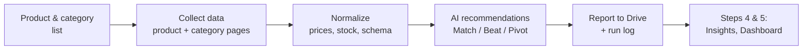

# PRD: Competitor Monitoring AI Agent

| | |
|---|---|
| **Pipeline step** | 3 of 5 · Moodboard → Trend Discovery → **Competitor Monitoring** → Insights & Content → Dashboard |
| **Owner** | Lashawn Fofung (Technical Product Manager and builder) |
| **Status** | MVP built · v1 requirements below |
| **Build** | [Lab 03 write-up](https://github.com/LashawnFofung/Agentic-Workflow-Hub/blob/main/Labs/Lab%2003%20Competitor%20Monitoring%20AI%20Agent.md) · [Workflow (v2)](https://github.com/LashawnFofung/Agentic-Workflow-Hub/blob/main/N8N%20Workflow/Final%20Deliverables/Competitor%20Monitoring%20AI%20Agent%20v2.json) · [Sample report](https://github.com/LashawnFofung/Agentic-Workflow-Hub/blob/main/Lab%20Artifacts/Lab%203/Competitor%20Analysis%20Report%20-%20Area%20Rugs.pdf) |

> *Externship project using Wayfair as the business case. Not affiliated with or endorsed by Wayfair.*

[← Back to project overview](../README.md)

---

## Contents
1. [Summary](#1-summary)
2. [Problem](#2-problem)
3. [Goals & Non-Goals](#3-goals--non-goals)
4. [Users & User Stories](#4-users--user-stories)
5. [Functional Requirements](#5-functional-requirements)
6. [Non-Functional Requirements](#6-non-functional-requirements)
7. [User Experience](#7-user-experience)
8. [Narrative](#8-narrative)
9. [Success Metrics](#9-success-metrics)
10. [Technical Considerations](#10-technical-considerations)
11. [Risks & Mitigations](#11-risks--mitigations)
12. [Open Questions](#12-open-questions)
13. [Milestones](#13-milestones)
14. [MVP Delivered vs. v1 Spec](#14-mvp-delivered-vs-v1-spec)

---

## 1. Summary

The Competitor Monitoring AI Agent checks competitor pricing and stock **daily** across Amazon and Walmart, compares it with Wayfair's listings, and recommends an action for each product: **Match, Beat, or Pivot**. It replaces slow weekly manual audits so pricing and category teams can respond the same day.

---

## 2. Problem

| | |
|---|---|
| **Today** | Pricing analysts check competitor prices by hand, once a week |
| **Reality** | Competitors change prices daily, about 7× faster than Wayfair reacts |
| **Cost** | Lost "Lowest Price" badges, missed chances when competitors run out of stock, and analyst hours spent copying prices into spreadsheets |

**Problem statement:** Pricing and category teams can't see competitor price and stock changes fast enough to act on them, so Wayfair loses price position and misses out-of-stock opportunities.

---

## 3. Goals & Non-Goals

### Business goals
| Goal | Target |
|---|---|
| Shorten the pricing audit cycle | Weekly → **daily** |
| Protect price position | **+15%** more days holding the Lowest Price badge on monitored products within 60 days |
| Capture competitor stock-outs | Flag every out-of-stock event on monitored products within 24 hours |
| Feed downstream agents | Deliver clean, structured data to Step 4 (Insights) and Step 5 (Dashboard) |

### User goals
- **Pricing Analysts** get up-to-date price comparisons and badge status by product and category, without manual collection.
- **Category Managers** are alerted when competitors go out of stock, so they can promote Wayfair alternatives.
- **Technical Product Owners** can see pipeline health, data quality, and run history without digging into logs.

### Non-goals (v1)
- **No automatic price changes.** The agent recommends; people decide.
- **Only Amazon and Walmart** as competitors in v1.
- **No dedicated front end.** Output is an HTML and PDF report in Google Drive, plus data for the dashboard.

---

## 4. Users & User Stories

| User | Story | Acceptance criteria |
|---|---|---|
| **Pricing Analyst** | As a Pricing Analyst, I want price comparisons for "5×7 shag rugs" across Amazon, Walmart, and Wayfair, so I can spot pricing gaps quickly. | Report shows all three prices and the gap for each matched product |
| **Pricing Analyst** | I want to know which products lost the Lowest Price badge, so I can prioritize pricing actions. | Badge status flagged per product; changes since the last run highlighted |
| **Pricing Analyst** | I want prices as clean numbers (e.g., `120.00`), so I can use them in calculations. | All prices stored as numbers, not text |
| **Category Manager** | I want alerts when competitor products go out of stock, so I can promote Wayfair alternatives. | Out-of-stock events appear in the report with suggested alternatives |
| **Category Manager** | I want to see where competitors lack assortment, so I can find whitespace. | Category-level gaps listed in the report |
| **Technical Product Owner** | I want run logs with product counts, error rates, and step status, so I can fix failures early. | Each run produces a log; failures trigger an alert |
| **Technical Product Owner** | I want to know when a retailer's page layout changes and breaks the pipeline. | Layout-change failures are detected, logged, and alerted, and don't stop the rest of the run |

---

## 5. Functional Requirements

| ID | Requirement | Priority |
|---|---|---|
| **Data collection** | | |
| FR-1 | Collect product data from both **product pages** and **category pages** (two different page structures) | P0 |
| FR-2 | Support at least **100 products per scheduled run** across both competitors | P0 |
| FR-3 | Use **approved data sources** (official retailer APIs, licensed data feeds, or collection within each site's terms of service) | P0 |
| **Data normalization** | | |
| FR-4 | Convert price text (e.g., "$120.00") into numbers | P0 |
| FR-5 | Detect and standardize out-of-stock flags and missing fields | P0 |
| FR-6 | Map all retailers to one consistent schema | P0 |
| **Recommendations** | | |
| FR-7 | Generate a **Match / Beat / Pivot** recommendation for each product: **Match** (price parity) · **Beat** (undercut by a set threshold, default 5%) · **Pivot** (suggest Wayfair alternatives when a competitor is out of stock) | P0 |
| FR-8 | Base every recommendation only on the current run's data, and show the inputs used | P0 |
| **Output** | | |
| FR-9 | Produce an HTML and PDF report in Google Drive, using consistent file names and dated folders | P1 |
| FR-10 | Pass structured data to Step 4 (Insights) and Step 5 (Dashboard) | P1 |
| FR-11 | Write a run log: product count, errors by type, duration, and data-quality checks | P1 |

---

## 6. Non-Functional Requirements

| Area | Requirement |
|---|---|
| **Reliability** | Pipeline uptime above 99% on scheduled runs; a failure on one product or retailer never stops the whole run |
| **Freshness** | Report available by 8 a.m. for a 6 a.m. run |
| **Accuracy** | Every price and stock status in the report traces back to collected data; the AI may summarize but not invent values |
| **Privacy** | No personal data collected; data kept only as long as needed to produce the report |
| **Accessibility** | Readable fonts, sufficient color contrast, and status labels that don't rely on color alone |
| **Compliance** | Data collection follows each retailer's terms of service, reviewed by legal before launch |

---

## 7. User Experience

### Flow

1. **Set up:** the Technical Product Owner confirms the product and category list and the run schedule.
2. **Collect:** the agent gathers data from product and category pages, logging any pages it can't reach.
3. **Normalize:** prices become numbers, stock status is standardized, and data is mapped to one schema.
4. **Recommend:** the AI assigns Match, Beat, or Pivot to each product.
5. **Deliver:** a report lands in Google Drive. Columns: Product · Category · Wayfair / Amazon / Walmart price · Gap · Badge status · Recommendation. The run log is saved alongside it.

### Edge cases
| Situation | Behavior |
|---|---|
| A retailer's page layout changes | Skip affected products, alert the owner, and continue the run |
| A competitor is out of stock with no Wayfair alternative | Mark "Pivot: no alternative found" |
| Google Drive upload fails | Retry up to 3 times, then alert |
| Very large runs | Process in batches; retry failed batches only |

---

## 8. Narrative

**Before:** Maya, a Pricing Analyst, spends Monday mornings checking dozens of rug listings on Amazon and Walmart, copying prices into a spreadsheet. By Wednesday she discovers a competitor has been undercutting her best-selling rugs for days, and Wayfair has lost the Lowest Price badge.

**After:** every morning at 6 a.m., the agent collects the latest prices and stock levels and recommends an action for each product. By 8 a.m., Maya's report is waiting in Google Drive, with price gaps highlighted and badge changes flagged. Meanwhile, James, a Category Manager, sees that a competitor's popular 5×7 shag rug is out of stock, and the report suggests three Wayfair alternatives to promote that day.

---

## 9. Success Metrics

| Type | Metric | Baseline | Target |
|---|---|---|---|
| **User** | Time from a competitor price change to it being flagged | ~7 days | **< 24 hours** |
| **User** | Pricing Analysts using the report weekly | 0 | **3+** within 30 days |
| **User** | Out-of-stock alerts acted on by Category Managers | — | Tracked monthly |
| **Business** | Days monitored products hold the Lowest Price badge | Current rate | **+15%** in 60 days |
| **Business** | Whitespace (out-of-stock) opportunities found per category | — | Tracked monthly |
| **Technical** | Products processed per run | — | **100+** at launch, 500+ in v2 |
| **Technical** | Layout-change failures detected and alerted | — | **100%**, with no silent failures |
| **Technical** | Pipeline uptime | — | **> 99%** |

**Tracking plan:** product count and coverage per run · errors by type · mix of Match / Beat / Pivot recommendations · Drive upload success rate · run duration.

---

## 10. Technical Considerations

| Component | Approach |
|---|---|
| **Orchestration** | n8n workflow on a schedule |
| **Data collection** | HTTP requests and HTML parsing (Cheerio), with separate paths for product and category pages; licensed feeds or APIs preferred for production |
| **Normalization** | JavaScript and regex to clean prices, stock status, and fields |
| **AI** | Gemini for analysis and recommendations; Mistral Large for structured synthesis |
| **Output** | Google Drive API for HTML/PDF reports and run logs |
| **Integrations** | **Upstream:** priority products and categories from Step 2 (Trend Discovery) · **Downstream:** structured data to Step 4 (Insights) and Step 5 (Dashboard) |

**Scalability:** batch processing for 100+ products at launch and 500+ in v2; collection and normalization can run in parallel by category.

---

## 11. Risks & Mitigations

| Risk | Likelihood | Impact | Mitigation |
|---|---|---|---|
| **Terms-of-service or legal limits on collecting retailer data** | High | High | Prefer official APIs and licensed data feeds; legal review before launch |
| **Retailer page layouts change** | High | Medium | Detect failures, alert the owner, and keep the run going; separate parsers per page type |
| **Requests blocked or rate-limited** | Medium | Medium | Respect rate limits, pace requests, and use licensed data where possible |
| **AI invents or misreads data** | Medium | High | Recommendations must cite collected values; automated checks flag numbers that don't appear in the source data |
| **Small samples mislead decisions** | Medium | Medium | Show the product count and scope on every report |
| **API limits or Drive outages** | Low | Medium | Retries with backoff; alerts on repeated failure |

---

## 12. Open Questions

1. Which licensed data provider or retailer API would replace page collection in production?
2. Should the "Beat" threshold be one fixed percentage or set per category?
3. How should products be matched across retailers when names and sizes differ?
4. Who owns the decision when a recommendation conflicts with a promotion already planned?

---

## 13. Milestones

**Estimate:** ~2 weeks for v1, built and owned end to end by Lashawn Fofung (engineering and product).

| Phase | Timing | Deliverables | Depends on |
|---|---|---|---|
| **1. Collection + normalization** | Days 1–5 | Product and category paths, price and stock cleaning; validated on 20 test products | Target product and category lists |
| **2. Recommendations + output** | Days 6–10 | Match / Beat / Pivot logic, Drive reports; end-to-end test on 100 products | AI and Drive credentials |
| **3. Hardening + handoff** | Days 11–14 | Failure detection and alerts, run logs, agreed data format for Steps 4 and 5, runbook | Downstream format confirmed |

---

## 14. MVP Delivered vs. v1 Spec

| Area | v1 spec | MVP as built |
|---|---|---|
| **Retailers** | Amazon and Walmart | ✅ Amazon and Walmart, **plus Wayfair as the baseline** for comparison |
| **Page types** | Product and category pages | ✅ Both paths built for Amazon |
| **AI analysis** | Gemini | ✅ Gemini 2.0 and Mistral Large |
| **Output** | HTML/PDF report in Drive | ✅ HTML report saved to dated Drive folders, used by the dashboard |
| **Recommendations** | Match / Beat / Pivot per product | ⚠️ Category-level strategy (pricing position, assortment gaps, opportunities), not yet per product |
| **Lowest Price badge tracking** | Per product | ❌ Not yet built |
| **Scale** | 100+ products per run | ⚠️ Sample run: 48 Wayfair, 7 Amazon, 1 Walmart |

**Lessons from the MVP**
- **AI output needs validation.** The sample report says Amazon rating data wasn't available, yet lists Amazon ratings in a table. Hence the accuracy requirement (Section 6) and the automated check on AI-stated numbers (Section 11).
- **Data access is the hardest part.** Retailer pages change and resist automated collection, which is why v1 prefers licensed data feeds and official APIs.
- **Scope must be visible.** With only a handful of competitor products in the sample, every report should state how much data it's based on.
