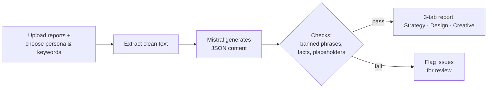

# PRD: AI Insights & Content Agent

| | |
|---|---|
| **Pipeline step** | 4 of 5 · Moodboard → Trend Discovery → Competitor Monitoring → **Insights & Content** → Dashboard |
| **Owner** | Lashawn Fofung (Technical Product Manager and builder) |
| **Status** | MVP built · v1 requirements below |
| **Build** | [Lab 04 write-up](https://github.com/LashawnFofung/Agentic-Workflow-Hub/blob/main/Labs/Lab%2004%20AI%20Insight%20and%20Content%20Agent.md) · [Workflow](https://github.com/LashawnFofung/Agentic-Workflow-Hub/blob/main/N8N%20Workflow/Content%20Strategy%20AI%20Agent.json) · [Sample output](https://github.com/LashawnFofung/Agentic-Workflow-Hub/blob/main/Lab%20Artifacts/Lab%204/Wayfair_Area_Rug_Content_Strategy.html) |

> *Externship project using Wayfair as the business case. Not affiliated with or endorsed by Wayfair.*

[← Back to project overview](../README.md)

---

## Contents
1. [Summary](#1-summary)
2. [Problem](#2-problem)
3. [Goals & Non-Goals](#3-goals--non-goals)
4. [Users & User Stories](#4-users--user-stories)
5. [Functional Requirements](#5-functional-requirements)
6. [Non-Functional Requirements](#6-non-functional-requirements)
7. [User Experience](#7-user-experience)
8. [Narrative](#8-narrative)
9. [Success Metrics](#9-success-metrics)
10. [Technical Considerations](#10-technical-considerations)
11. [Risks & Mitigations](#11-risks--mitigations)
12. [Open Questions](#12-open-questions)
13. [Milestones](#13-milestones)
14. [MVP Delivered vs. v1 Spec](#14-mvp-delivered-vs-v1-spec)

---

## 1. Summary

The AI Insights & Content Agent turns the trend report (Step 2) and competitor report (Step 3) into **brand-aligned marketing content**: an editorial strategy, social captions, email headers, and design direction (colors, textures, layout ideas). Content teams pick a style persona and keywords, and the agent drafts on-brand copy in minutes instead of days. **Every claim it makes must trace back to the source reports.**

---

## 2. Problem

| | |
|---|---|
| **Today** | Content strategists dig through trend and competitor reports by hand, then write copy for each channel separately |
| **Time** | A campaign creative brief takes about **5 business days** |
| **Quality** | Rushed copy falls back on generic phrases like "elevate your space," which weakens the brand |

**Problem statement:** Content teams can't turn market insights into on-brand, multi-channel content fast enough to act while a trend is still rising.

---

## 3. Goals & Non-Goals

### Business goals
| Goal | Target |
|---|---|
| Speed up content creation | Creative brief: ~5 days → **under 3 minutes** for a first draft |
| Protect brand voice | **85%+** of drafts need no cleanup of generic or off-brand phrases |
| Scale multi-channel output | One run produces editorial, Instagram, and email copy |
| Feed design teams | Every run includes structured design direction: hex colors, textures, layout ideas |
| **Keep content truthful** | **100%** of statistics in the output appear in the source reports |

### User goals
- **Content Strategists** turn reports into targeted copy for a chosen style without copying and pasting.
- **Creative Directors** change the style or tone rules without editing code.
- **Marketing Managers** grab ready-to-use headlines and captions for quick A/B tests.

### Non-goals (v1)
- **No automatic publishing** to social channels or the website. People review and post.
- **No image generation.** v1 delivers text and design specs; the Moodboard agent handles images.
- **No audio or video inputs.** Inputs are the structured reports from Steps 2 and 3.

---

## 4. Users & User Stories

| User | Story | Acceptance criteria |
|---|---|---|
| **Content Strategist** | As a Content Strategist, I want to upload the trend and competitor reports, so the agent extracts insights without manual copying. | Both reports accepted; key facts extracted and listed with their source |
| **Content Strategist** | I want to choose a style persona (e.g., Earthy Organic, Minimalist, Maximalist), so copy fits a specific aesthetic. | Output reflects the chosen persona; changing it changes the copy |
| **Content Strategist** | I want generic phrases like "elevate your space" filtered out, so I spend less time editing. | Banned phrases never appear in the output |
| **Content Strategist** | I want every statistic to cite its source report, so I can trust it in a campaign. | Each number links to the report and passage it came from |
| **Marketing Manager** | I want one-click copy buttons for captions and headlines, so I can set up channel tests quickly. | Each copy block has a working copy button |
| **Marketing Manager** | I want to mark each content piece as To Do, Drafting, or Ready, so I can track campaign prep. | Status changes are saved between visits |

---

## 5. Functional Requirements

| ID | Requirement | Priority |
|---|---|---|
| **Input** | | |
| FR-1 | Accept the Step 2 and Step 3 reports (HTML) and convert them to clean text | P0 |
| FR-2 | Input form with a Style Persona dropdown and a free-text Vibe Keywords field | P0 |
| **Generation** | | |
| FR-3 | Use a role-based prompt that sets the model up as a senior content strategist | P0 |
| FR-4 | Return output in a strict JSON format with: `editorial_strategy`, `instagram_caption`, `email_header`, and `mood_board_assets` (hex colors, textures, layout ideas) | P0 |
| FR-5 | **Anti-AI-ism filter:** block phrases such as "elevate your space," "sanctuary," "game changer," and "redefine your home"; the list is editable without code changes | P0 |
| **Grounding & quality** | | |
| FR-6 | **Use only facts from the source reports.** The prompt must forbid outside statistics, and every number must cite its source | P0 |
| FR-7 | **Automated fact check:** before display, confirm every number in the output appears in the source reports; flag any that don't | P0 |
| FR-8 | **Template check:** confirm all placeholders (e.g., category name) are filled before the report is delivered | P0 |
| FR-9 | If the JSON is malformed, repair it or show the raw text safely, without breaking the page | P1 |
| FR-10 | If design assets are missing, show default brand colors so the design section still renders | P1 |
| **Output** | | |
| FR-11 | Interactive report with three tabs: **Strategy · Design · Creative** | P1 |
| FR-12 | Status tracker (To Do / Drafting / Ready) saved in the browser | P1 |
| FR-13 | One-click copy for every caption and headline; print-ready layout for PDF | P1 |

---

## 6. Non-Functional Requirements

| Area | Requirement |
|---|---|
| **Accuracy** | No invented statistics; every fact traceable to a source report (FR-6, FR-7) |
| **Speed** | A full run finishes in under **3 minutes**; target under 90 seconds |
| **Reliability** | 100% of runs produce valid JSON or a safe fallback; no broken pages |
| **Privacy** | No personal data collected; status tracking stays in the user's browser |
| **Accessibility** | Readable fonts, sufficient contrast, keyboard-usable copy buttons and tabs |

---

## 7. User Experience

1. **Input:** the user uploads the trend and competitor reports, picks a persona (e.g., Maximalist), and adds keywords (e.g., "velvet texture").
2. **Extract:** the workflow strips formatting and pulls the key facts.
3. **Generate:** Mistral writes the content under the persona, banned-phrase, and grounding rules.
4. **Check:** automated checks catch banned phrases, numbers not found in the sources, and unfilled placeholders.
5. **Review:** the user moves through the Strategy, Design, and Creative tabs, updates statuses, copies text, and prints to PDF.

---

## 8. Narrative

**Before:** Elena, a Digital Content Planner, spends Thursday morning digging through trend and competitor reports to plan next week's campaign. Writing versions for each channel takes hours, and she keeps catching herself using the same tired phrases.

**After:** Elena uploads both reports, picks "Earthy Organic," and types "terracotta, handcrafted." Within about 90 seconds, she has a three-tab report. The Creative tab has an Instagram caption that sounds human, the Design tab shows a palette with hex codes ready for the design studio, and every statistic links back to the report it came from. She marks a caption Ready, copies it into her scheduler, and prints the report for her creative director.

---

## 9. Success Metrics

| Type | Metric | Baseline | Target |
|---|---|---|---|
| **User** | Time to draft multi-channel copy | Hours (≈5-day brief cycle) | **< 3 minutes** |
| **User** | Copy-button use per report | — | Tracked |
| **User** | Distinct personas used per month | — | **3+** |
| **Quality** | Drafts needing no phrase cleanup | — | **> 85%** |
| **Quality** | Statistics traceable to a source report | — | **100%** |
| **Quality** | Reports with unfilled placeholders | — | **0** |
| **Technical** | Runs producing valid JSON | — | **100%** (with fallback) |
| **Technical** | Runs including complete design assets | — | Tracked |

---

## 10. Technical Considerations

| Component | Approach |
|---|---|
| **Orchestration** | n8n workflow with an upload form trigger |
| **Model** | Mistral (`mistral-large-latest`) |
| **Prompting** | Role-based system prompt, strict JSON schema, banned-phrase list, and a "use only the provided reports" rule |
| **Validation** | Code steps that check phrases, numbers, and placeholders before rendering |
| **Front end** | HTML, CSS, and JavaScript generated from the JSON; browser storage for status tracking |
| **Integrations** | **Upstream:** Step 2 (trends) and Step 3 (competitors) reports · **Downstream:** content and palette data for the Step 5 dashboard |

---

## 11. Risks & Mitigations

| Risk | Likelihood | Impact | Mitigation |
|---|---|---|---|
| **AI invents statistics** | **High (seen in MVP)** | **High** | "Source-only" prompt rule, required citations, and an automated number check (FR-6, FR-7) |
| **Template placeholders left unfilled** | **High (seen in MVP)** | Medium | Validate all fields before rendering (FR-8) |
| Malformed JSON | Medium | Medium | Repair step with safe fallback (FR-9) |
| Generic or off-brand tone | Medium | Medium | Banned-phrase filter plus persona rules; track the cleanup rate |
| Thin source reports produce thin content | Medium | Medium | Show how much source data each insight is based on |

---

## 12. Open Questions

1. Who owns the banned-phrase list, and how often should it be reviewed?
2. Should flagged (unverified) numbers be removed automatically or shown for human review?
3. What brand-voice guidelines should the persona definitions draw from?

---

## 13. Milestones

**Estimate:** ~1 week, built end to end by Lashawn Fofung (engineering, prompting, and front end). The base workflow was inherited and extended.

| Phase | Timing | Deliverables | Depends on |
|---|---|---|---|
| **1. Inputs & prompting** | Days 1–2 | Report upload and text extraction; persona, keywords, and banned-phrase rules | Mistral API key |
| **2. Interface** | Days 3–4 | Three-tab report, status tracker, copy buttons, print layout | Valid JSON from Phase 1 |
| **3. Validation & hardening** | Days 5–7 | Fact and placeholder checks, JSON repair, stress tests, documentation | Step 5 data format agreed |

---

## 14. MVP Delivered vs. v1 Spec

| Area | v1 spec | MVP as built |
|---|---|---|
| **Inputs** | Upload Step 2 and Step 3 reports | ✅ Report upload and text extraction |
| **Persona and keywords** | Dropdown and free text | ✅ Added to the inherited form |
| **Anti-AI-ism filter** | Banned phrases blocked | ✅ None of the banned phrases appear in the sample output |
| **Structured output** | JSON with design assets | ✅ Strategy, content ideas, and campaigns generated |
| **Three-tab app, status tracker, copy buttons** | Interactive report | ✅ Built (per the Lab 04 write-up); the sample file in the repo is the earlier static version |
| **Grounding in source reports** | Every number traceable | ❌ **Failed in the sample:** statistics such as "28% YoY growth," "47% sustainability searches," "62% mobile traffic," and an IKEA comparison don't appear in the source reports |
| **Placeholders filled** | No unfilled fields | ❌ **Failed in the sample:** `{{ $json.category }}` and `{{ $json.focus }}` appear 51 times |

**Lessons from the MVP**
- **Fluent isn't the same as true.** The sample report reads well and labels its numbers as "from your Project 2 and Project 3 reports," but those numbers aren't in either report. For an AI content tool, grounding is a P0 requirement, not a nice-to-have, so FR-6 and FR-7 were added.
- **Test the output, not just the workflow.** The workflow ran successfully but delivered unfilled placeholders. Automated output checks (FR-8) catch what a "successful run" hides.
- **The tone filter worked.** The banned-phrase rules held, showing that prompt constraints can reliably shape style, while factual accuracy needs a separate check.
