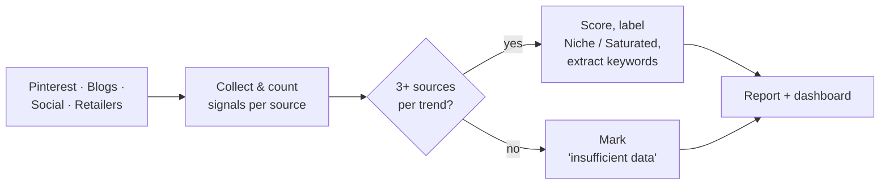

# PRD: Market Trend Discovery AI Agent

| | |
|---|---|
| **Pipeline step** | 2 of 5 · Moodboard → **Trend Discovery** → Competitor Monitoring → Insights & Content → Dashboard |
| **Owner** | Lashawn Fofung (Technical Product Manager and builder) |
| **Status** | MVP built · v1 requirements below |
| **Build** | [Lab 02 write-up](https://github.com/LashawnFofung/Agentic-Workflow-Hub/blob/main/Labs/Lab%2002%20Discovery%20AI%20Agent.md) · [Workflow (v2)](https://github.com/LashawnFofung/Agentic-Workflow-Hub/blob/main/N8N%20Workflow/Final%20Deliverables/Market%20Trend%20Discovery%20v2.json) · [Sample report: Shag Rugs](https://github.com/LashawnFofung/Agentic-Workflow-Hub/blob/main/Lab%20Artifacts/Lab%202/Shag%20Rug%20Trend%20Report.pdf) |

> *Externship project using Wayfair as the business case. Not affiliated with or endorsed by Wayfair.*

[← Back to project overview](../README.md)

---

## Contents
1. [Summary](#1-summary)
2. [Problem](#2-problem)
3. [Goals & Non-Goals](#3-goals--non-goals)
4. [Users & User Stories](#4-users--user-stories)
5. [Functional Requirements](#5-functional-requirements)
6. [Non-Functional Requirements](#6-non-functional-requirements)
7. [User Experience](#7-user-experience)
8. [Narrative](#8-narrative)
9. [Success Metrics](#9-success-metrics)
10. [Technical Considerations](#10-technical-considerations)
11. [Risks & Mitigations](#11-risks--mitigations)
12. [Open Questions](#12-open-questions)
13. [Milestones](#13-milestones)
14. [MVP Delivered vs. v1 Spec](#14-mvp-delivered-vs-v1-spec)

---

## 1. Summary

The Market Trend Discovery AI Agent watches Pinterest, design blogs, social media, and retailer listings to spot the next **"hero" products** in home décor before they show up in sales data. It gives each trend a **Trend Confidence Score** based on how many independent sources support it, labels it **Niche** or **Saturated**, and delivers the results in a scheduled report and a live dashboard for Inventory Planners, Trend Researchers, and SEO Specialists.

---

## 2. Problem

| | |
|---|---|
| **Today** | Teams rely on sales data and manual research across Pinterest, blogs, and retailers |
| **Lag** | Sales data shows a trend **4–6 weeks** after it starts, or longer |
| **Cost** | Trending styles are under-stocked, fading ones are over-stocked, and researchers spend hours sifting noisy sources |

**Problem statement:** By the time a trend appears in sales data, the best time to stock it has passed, and manual research is too slow and too noisy to close the gap.

---

## 3. Goals & Non-Goals

### Business goals
| Goal | Target |
|---|---|
| Cut manual trend research time | **−80%**, measured with before/after time tracking |
| Spot trends earlier | Identify hero products about **3 weeks** before competitors |
| Keep signals relevant | **95%** of surfaced trends judged relevant in spot audits |
| Improve inventory decisions | Less overstock of "Saturated" styles; earlier stock of rising ones |

### User goals
- **Inventory Planners** stock trending materials and colors (e.g., "washable," "terracotta") before they peak, backed by a confidence score.
- **Trend Researchers** find niche styles early and see which are already saturated.
- **SEO Specialists** get trending keywords and their momentum to update product copy.

### Non-goals (v1)
- **No competitor price matching.** That's Step 3 (Competitor Monitoring).
- **No customer-facing features.** Internal use only.
- **No real-time pricing data.**

---

## 4. Users & User Stories

| User | Story | Acceptance criteria |
|---|---|---|
| **Inventory Planner** | As an Inventory Planner, I want a confidence score for materials like "terracotta rugs," so I can recommend stock increases with confidence. | Each trend shows a score and the sources behind it |
| **Inventory Planner** | I want trends broken out by product category, so decisions stay relevant to each line. | Results filter by category with no mixing between categories |
| **Trend Researcher** | I want to find niche styles before they go mainstream, so our catalog stays ahead. | Trends are labeled Niche or Saturated |
| **Trend Researcher** | I want to see why a trend is labeled Niche or Saturated, so I can focus my research. | Each label shows the evidence behind it |
| **SEO Specialist** | I want trending keywords from top trend signals, so I can update product descriptions. | Keywords listed for each trend |
| **SEO Specialist** | I want a momentum indicator for each keyword, so I can prioritize updates. | Keywords marked rising, steady, or falling |

---

## 5. Functional Requirements

| ID | Requirement | Priority |
|---|---|---|
| **Data collection** | | |
| FR-1 | Collect trend and product signals from **Pinterest, design blogs, social media, and retailer listings**, using approved APIs or data providers | P0 |
| FR-2 | Keep data separated by category (e.g., Rugs, Lighting) so one category's trends never mix with another's | P0 |
| FR-3 | **Report how much data each source returned** on every run, including zero | P0 |
| **Analysis** | | |
| FR-4 | Classify each trend as **Niche** or **Saturated**, with the reason | P0 |
| FR-5 | Calculate a **Trend Confidence Score** from at least **three independent sources** per trend | P0 |
| FR-6 | **Minimum-evidence rule:** if fewer than three sources support a trend, show "insufficient data" instead of a score. If the whole run has too little data, label the report "low confidence" rather than presenting firm findings | P0 |
| FR-7 | Separate **findings from collected data** from **AI background knowledge** (e.g., market size estimates), and label which is which | P0 |
| FR-8 | Extract trending keywords with a momentum indicator | P1 |
| **Output** | | |
| FR-9 | Generate a trend report (HTML/PDF) on a schedule (weekly or monthly) and on demand | P1 |
| FR-10 | Feed a live dashboard showing scores, labels, keywords, and category filters | P1 |
| FR-11 | Let users mark a trend **Watch** or **Dismiss**, and log those choices | P2 |

---

## 6. Non-Functional Requirements

| Area | Requirement |
|---|---|
| **Accuracy** | Every trend claim cites its supporting sources; no claims about "sales leaders" without sales data |
| **Freshness** | Dashboard updates within 5 minutes of new data; stale data shows a warning |
| **Reliability** | 100% of scheduled reports generated, or a clear failure alert |
| **Scalability** | New categories and sources added without slowing the pipeline; supports dozens of concurrent internal users |
| **Privacy** | Internal access only; stale signals purged quarterly |
| **Accessibility** | Score tiers shown with labels, not color alone; keyboard navigation and screen reader support |

---

## 7. User Experience

1. **Land on the summary:** top trends across categories, each with a confidence score, Niche/Saturated label, and last-updated time.
2. **Filter by category:** choose Rugs, Lighting, and so on; data never mixes across categories.
3. **Drill into a trend** (e.g., "Terracotta Rugs"): see the source breakdown (Pinterest, blogs, retail), how the score was built, related keywords with momentum, and history over time.
4. **Get reports:** request a PDF on demand, or receive scheduled weekly or monthly reports.

### Edge cases
| Situation | Behavior |
|---|---|
| Fewer than 3 sources for a trend | Show "insufficient data"; no score |
| A source returns no data | Report "0 results" for that source, and lower the report's overall confidence |
| Data older than the refresh window | Show a stale-data warning |

---

## 8. Narrative

**Before:** Jamie, a Trend Researcher, spends hours each day scrolling Pinterest boards and design blogs, trying to tell whether "terracotta rugs" is a passing fad or the next big thing. Lee, an Inventory Planner, needs a clear signal before adding terracotta to next quarter's order, and Sam in SEO wants data to guide product copy.

**After:** Jamie opens the dashboard and sees "Terracotta Rugs" with a **High** confidence score, labeled **Niche**, supported by Pinterest, recent blogs, and retailer listings, each with a timestamp. Lee adds terracotta to the order early, ahead of slower competitors. Sam spots "washable terracotta" rising as a keyword and updates product descriptions that afternoon.

---

## 9. Success Metrics

| Type | Metric | Target |
|---|---|---|
| **User** | Time spent on manual trend research | **−80%** (before/after time tracking) |
| **User** | User satisfaction | **≥ 4/5** in a quarterly survey |
| **User** | Report requests and dashboard filter use | Tracked |
| **Business** | Hero products identified before the market peak | Tracked per quarter |
| **Business** | Overstock of products flagged "Saturated" | Reduced year over year |
| **Quality** | Trends relevant in spot audits | **95%** |
| **Quality** | Trends shown with a score that have 3+ supporting sources | **100%** |
| **Technical** | Dashboard refresh after new data | **< 5 minutes** |
| **Technical** | Scheduled reports generated | **100%** |

**Tracking plan:** dashboard opens per user · filter use by category · on-demand report requests · score views per trend · Watch/Dismiss actions · **results returned per source per run**.

---

## 10. Technical Considerations

| Component | Approach |
|---|---|
| **Orchestration** | n8n on a schedule |
| **Data collection** | Social and blog signals via a third-party data API; retailer listings via HTTP and HTML parsing (approved sources preferred for production) |
| **AI** | **Mistral** cleans and classifies product data; **Gemini** synthesizes insights and writes the report |
| **Images** | Hugging Face FLUX for trend imagery |
| **Output** | HTML/PDF report saved to dated Google Drive folders; data feeds the Step 5 dashboard |
| **Integrations** | **Downstream:** priority products for Step 3 (Competitor Monitoring); trends for Step 4 (Content) and Step 5 (Dashboard) |

---

## 11. Risks & Mitigations

| Risk | Likelihood | Impact | Mitigation |
|---|---|---|---|
| **A data source returns nothing, and the AI fills the gap with general knowledge** | **High (seen in MVP)** | **High** | Report results per source (FR-3), minimum-evidence rule (FR-6), and labeling of AI background knowledge (FR-7) |
| Noisy or low-quality sources dilute scores | Medium | Medium | Source quality filters plus manual spot audits |
| Category data mixes as new categories are added | Low | Medium | Separate storage and checks per category |
| API limits or outages | Medium | Medium | Retries and alerts; partial reports clearly labeled |
| Terms-of-service limits on collecting data | Medium | High | Approved APIs and licensed data providers |

---

## 12. Open Questions

1. How should sources be weighted in the confidence score (e.g., is a Pinterest save worth less than a blog feature)?
2. What's the cutoff between Niche and Saturated: share of listings, growth rate, or both?
3. Which data provider gives reliable access to Pinterest and Instagram signals?

---

## 13. Milestones

**Estimate:** ~2 weeks, built and owned end to end by Lashawn Fofung (product and engineering).

| Phase | Timing | Deliverables | Depends on |
|---|---|---|---|
| **1. Collection & category separation** | Days 1–4 | Source connections, per-source result counts, separate data by category | Data API access |
| **2. Scoring & labels** | Days 5–8 | Confidence score (3+ sources), minimum-evidence rule, Niche/Saturated labels | Phase 1 data |
| **3. Reports & dashboard** | Days 9–11 | Scheduled and on-demand reports, dashboard feed, keyword module | Phase 2 |
| **4. QA & launch** | Days 12–14 | Relevance spot audits (target 95%), end-to-end tests, user guide | All features complete |

---

## 14. MVP Delivered vs. v1 Spec

*Based on the Shag Rug sample report generated March 31, 2026.*

| Area | v1 spec | MVP as built |
|---|---|---|
| **Report** | Scheduled trend report | ✅ 12-page report: executive summary, market data, buyer profile, micro-segments, recommendations, and watch list |
| **AI models** | Gemini | ✅ Mistral for classification, Gemini for synthesis |
| **Images** | — | ✅ FLUX trend imagery (added beyond spec) |
| **Retailer data** | Retailer listings | ⚠️ 6 Amazon products |
| **Social and blog data** | Pinterest, Instagram, blogs | ❌ **0 Instagram posts, 0 Pinterest pins, 0 blog articles** returned |
| **Confidence score** | Per trend, from 3+ sources | ❌ Not yet built |
| **Niche / Saturated labels** | Per trend | ❌ Not yet built |
| **SEO keywords and momentum** | Per trend | ❌ Not yet built |
| **Dashboard** | Live Google Sheets | 🔄 Changed: HTML dashboard built in Step 5, fed by reports in Google Drive |

**Lessons from the MVP**
- **Sources can fail silently.** The social and blog sources returned nothing, but the report still read as confident, with claims like "Gray and Black leading sales" drawn from six product listings and the AI's general knowledge. The report did list its sources, which is how the gap was caught. v1 makes this a rule: count results per source (FR-3), and lower confidence when evidence is thin (FR-6).
- **Label what's collected vs. what the AI knows.** Market size and buyer profiles are useful context, but they come from the model, not the run's data. FR-7 requires labeling the difference.
- **The confidence score is the product.** Without it, the report is a well-written opinion. The scoring and evidence rules are what make the agent trustworthy enough for stocking decisions.
