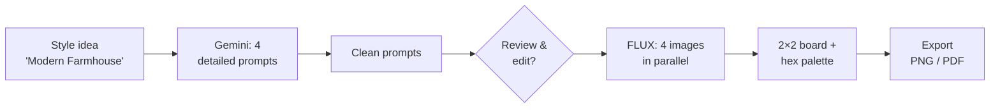

# PRD: Moodboard AI Agent

| | |
|---|---|
| **Pipeline step** | 1 of 5 · **Moodboard** → Trend Discovery → Competitor Monitoring → Insights & Content → Dashboard |
| **Owner** | Lashawn Fofung (Technical Product Manager and builder) |
| **Status** | MVP built · v1 requirements below |
| **Build** | [Lab 01 write-up](https://github.com/LashawnFofung/Agentic-Workflow-Hub/blob/main/Labs/Lab%2001%3A%20Moodboard%20Generator%20AI%20Agent.md) · [Workflow (JSON)](https://github.com/LashawnFofung/Agentic-Workflow-Hub/blob/main/N8N%20Workflow/Moodboard%20Agent%20N8N%20Workflow.json) · [Sample output: Scandinavian jute rug](https://github.com/LashawnFofung/Agentic-Workflow-Hub/blob/main/Lab%20Artifacts/Lab%201/Moodboard%20Agent%20Output%20Round%20Jute%20Rug%20Scandinavian.png) · [Demo](https://youtu.be/d6nro9oYpK4) |

> *Externship project using Wayfair as the business case. Not affiliated with or endorsed by Wayfair.*

[← Back to project overview](../README.md)

---

## Contents
1. [Summary](#1-summary)
2. [Problem](#2-problem)
3. [Goals & Non-Goals](#3-goals--non-goals)
4. [Users & User Stories](#4-users--user-stories)
5. [Functional Requirements](#5-functional-requirements)
6. [Non-Functional Requirements](#6-non-functional-requirements)
7. [User Experience](#7-user-experience)
8. [Narrative](#8-narrative)
9. [Success Metrics](#9-success-metrics)
10. [Technical Considerations](#10-technical-considerations)
11. [Risks & Mitigations](#11-risks--mitigations)
12. [Open Questions](#12-open-questions)
13. [Milestones](#13-milestones)
14. [MVP Delivered vs. v1 Spec](#14-mvp-delivered-vs-v1-spec)

---

## 1. Summary

The Moodboard AI Agent turns a style idea such as "Modern Farmhouse" or "Coastal Luxe" into a visual moodboard **in under 60 seconds**. Google Gemini expands the idea into detailed image prompts, and the Hugging Face **FLUX** model generates the images. The tool replaces hours of manual image sourcing for Creative Directors, Social Media Managers, and Interior Designers at the start of a campaign.

---

## 2. Problem

| | |
|---|---|
| **Today** | Creative teams build seasonal moodboards by hand, searching Pinterest and stock libraries and sharing drafts over Slack and email |
| **Time** | Hours per board, before any creative work starts |
| **Cost** | Slow campaign kickoff, fewer concepts explored, and a less consistent visual direction across teams |

**Problem statement:** Turning an abstract style idea into a shared visual takes hours of manual sourcing, which slows campaign kickoff and limits how many concepts a team can explore.

---

## 3. Goals & Non-Goals

### Business goals
| Goal | Target |
|---|---|
| Remove the manual image-sourcing step | Moodboard creation from **hours to under 60 seconds** |
| Increase design throughput | More concepts explored per seasonal launch |
| Drive adoption | Active use by **all three personas within 60 days** of launch |

### User goals
- **Rapid prototyping:** turn a style idea into a finished moodboard right away.
- **On-brand output:** visuals that follow brand guidelines without endless curation.
- **Client-ready concepts:** show the "feel" of a concept before choosing specific products.
- **Faster alignment:** get stakeholder buy-in with visuals instead of descriptions.

### Non-goals (v1)
- **No product or catalog integration.** No SKU selection, tagging, or pricing.
- **No post-moodboard workflow,** such as campaign scheduling or asset management.
- **No customer-facing or published imagery.** Boards are internal concept material.

---

## 4. Users & User Stories

| User | Story | Acceptance criteria |
|---|---|---|
| **Creative Director** | As a Creative Director, I want to enter a theme (e.g., "Midcentury Cozy") so I can prototype campaign looks without searching for images. | A complete board is returned in under 60 seconds |
| **Creative Director** | I want to review the AI's prompts before images are generated, so I keep creative control. | Prompts can be edited or approved before generation |
| **Social Media Manager** | I want on-brand moodboards for trending styles, so my content stays current. | Boards follow the saved brand style settings |
| **Social Media Manager** | I want to export the board and palette for post templates. | One-click export as PNG or PDF |
| **Interior Designer** | I want a "concept feel" for client pitches without choosing products. | 4 distinct, relevant images per board |
| **Interior Designer** | I want a color palette with hex codes to share with clients and contractors. | 4–6 hex codes shown, each copyable |

---

## 5. Functional Requirements

| ID | Requirement | Priority |
|---|---|---|
| **Prompting** | | |
| FR-1 | Accept a style idea as text; if it's empty or unclear, suggest example ideas | P0 |
| FR-2 | Gemini expands the idea into **4 visually distinct, detailed image prompts** | P0 |
| FR-3 | **Clean each prompt** before sending it to the image model (remove line breaks, Markdown, and characters that break the API request) | P0 |
| FR-4 | Show the prompts for review and editing before generation | P1 |
| FR-5 | Apply saved **brand style settings** (colors, materials, tone) to every prompt | P1 |
| **Images** | | |
| FR-6 | Generate 4 images with FLUX **in parallel** and show them in a 2×2 grid | P0 |
| FR-7 | If one image fails, keep the grid, show a placeholder with the error, and allow a retry of that slot | P1 |
| FR-8 | Retry API calls up to 3 times with backoff before showing an error | P1 |
| **Palette & export** | | |
| FR-9 | Extract **4–6 main colors** from the images and show them as swatches with hex codes, each copyable | P1 |
| FR-10 | Export the board and palette as one PNG or PDF | P1 |
| FR-11 | Label exported boards **"AI-generated concept"** | P1 |

---

## 6. Non-Functional Requirements

| Area | Requirement |
|---|---|
| **Speed** | 95% of boards complete in under 60 seconds |
| **Reliability** | 99% or more of API calls succeed or recover on retry |
| **Privacy** | No user accounts and no stored history. Style ideas and prompts **are sent to Google (Gemini) and Hugging Face (FLUX)**, so users shouldn't enter confidential product plans until vendor data terms are approved |
| **Security** | API keys stored as credentials, never in workflow files or the repo |
| **Accessibility** | Hex codes readable at high contrast; keyboard navigation; images have alt text from their prompts |
| **Devices** | Optimized for desktop and tablet |

---

## 7. User Experience

1. **Enter an idea:** one large input field. A short first-time overlay explains the flow; no login is required.
2. **Review prompts:** the four prompts appear next to the original idea; edit any of them or approve all.
3. **Generate:** a progress indicator shows each image; retries are shown as they happen ("Retrying, hang tight").
4. **View the board:** four images in a 2×2 grid, with a palette strip of hex codes underneath.
5. **Export:** one click downloads the board and palette, with a confirmation message.

### Edge cases
| Situation | Behavior |
|---|---|
| Empty or unclear idea | Suggest examples and ask for more detail |
| API rate limit or timeout | Retry up to 3 times, then show an error with next steps |
| One image fails | Placeholder in that slot with the error and a retry button |

---

## 8. Narrative

A Creative Director at a home goods brand is starting work on the autumn collection. She needs her team to agree on a look, something like "Warm Minimalist Autumn," that will guide marketing, styling, and product direction. Normally that means half a day of Pinterest searches, collecting images, and rounds of feedback over Slack and email.

Today she types "Warm Minimalist Autumn" into the Moodboard AI Agent. Gemini suggests four prompts: cozy textures, muted foliage colors, sculptural modern furniture, and soft seasonal light. She tweaks one and approves. Four images appear as a moodboard, with a palette of hex codes underneath.

In about a minute she exports the board and shares it with the team. Visual direction is set on day one, and the team spends its time on the creative work instead of the searching.

---

## 9. Success Metrics

| Type | Metric | Target |
|---|---|---|
| **User** | Boards delivered in under 60 seconds | **≥ 95%** |
| **User** | Stakeholders rating the board "on-point" | **≥ 90%** in post-session surveys |
| **User** | Boards created and exported per user per week | Tracked |
| **Business** | Median time to first visual in tracked projects | **Under 5 minutes** (from hours) |
| **Business** | Active personas within 60 days | **3 of 3** |
| **Technical** | API success rate, including retries | **> 99%** |
| **Technical** | P95 time from idea to finished board | **< 60 seconds** |

**Tracking plan:** ideas submitted · prompts edited vs. approved as-is · images generated and failed · retries · palette copies · exports.

---

## 10. Technical Considerations

| Component | Approach |
|---|---|
| **Orchestration** | n8n workflow: chat trigger → AI Agent → code node → HTTP request |
| **Prompting** | n8n AI Agent node with Google Gemini and a system message that sets the role ("expert image generation prompt engineer") and rules for style, color, texture, and layout |
| **Prompt cleaning** | JavaScript code node that removes line breaks and Markdown and replaces double quotes, so the prompt fits in the API's JSON body |
| **Image generation** | Hugging Face Inference API, **FLUX.1-schnell** (a fast model), returning PNG |
| **Palette** | Color quantization on the generated images (v1) |
| **Front end** | n8n chat for the MVP; a simple web UI for v1 |
| **Reuse** | The same Gemini → clean → FLUX pattern generates trend imagery in Step 2 (Market Trend Discovery) |

---

## 11. Risks & Mitigations

| Risk | Likelihood | Impact | Mitigation |
|---|---|---|---|
| AI output breaks the image API request (line breaks, quotes, Markdown) | **High (seen in MVP)** | High | Prompt-cleaning step (FR-3), now part of the design |
| Images drift from brand guidelines | Medium | Medium | Brand style settings in every prompt (FR-5) and prompt review (FR-4) |
| Generated images treated as real products or used publicly | Medium | High | "AI-generated concept" label on exports (FR-11) and internal-use non-goal |
| Confidential plans sent to third-party AI services | Medium | High | Clear privacy guidance; approved vendor terms before wider rollout |
| Rate limits on the free Hugging Face tier | Medium | Medium | Retries with backoff; paid or dedicated endpoint for production |

---

## 12. Open Questions

1. Should brand style settings be one shared profile, or one per campaign or brand line?
2. Is one composed collage image (the MVP approach) good enough for some uses, as a faster and cheaper "quick look" mode?
3. What usage rights and disclosure rules apply to AI-generated images used in client presentations?

---

## 13. Milestones

**Estimate:** ~2 weeks, built and owned end to end by Lashawn Fofung (product, design, and engineering).

| Phase | Timing | Deliverables | Depends on |
|---|---|---|---|
| **1. Core pipeline** | Days 1–5 | Idea → Gemini prompt → cleaned prompt → FLUX image, working end to end | Gemini and Hugging Face API keys |
| **2. Full board** | Days 6–10 | 4 parallel images, prompt review, palette extraction, retries, export | Stable Phase 1 pipeline |
| **3. Validate & launch** | Days 11–14 | Testing with creative, social, and design users; speed tuning to under 60 seconds; bug fixes | All features complete |

---

## 14. MVP Delivered vs. v1 Spec

*Based on the Lab 01 build and its sample run ("round jute rug, Scandinavian").*

| Area | v1 spec | MVP as built |
|---|---|---|
| **Speed** | Under 60 seconds | ✅ **12.4 seconds** end to end; image step 3.3 seconds; 475 Gemini tokens |
| **Prompting** | Gemini expands the idea | ✅ Gemini AI Agent with a role-based system message |
| **Prompt cleaning** | — | ✅ Added during the build (now FR-3) |
| **Images** | 4 images in a 2×2 grid | 🔄 Changed: **one 1024×1024 image** that FLUX composes as a moodboard collage (texture close-ups plus a styled room) |
| **Input** | Web UI | 🔄 n8n chat interface |
| **Prompt review** | Edit before generating | ❌ Not built |
| **Hex palette and export** | 4–6 hex codes; PNG/PDF export | ❌ Not built |
| **Retries** | Up to 3 with backoff | ❌ Not built |
| **Scope** | Any home décor style | ⚠️ System prompt is tuned for **rugs**, matching the externship's focus category |

**Lessons from the MVP**
- **The model-to-model handoff is where things break.** Gemini's formatted output (line breaks, Markdown, quotes) broke the JSON request to Hugging Face. A small cleaning step fixed it, and that pattern was reused in later agents.
- **Prove the pipeline before the polish.** One composed image proved the core idea (text to on-theme visual) in about 12 seconds. The 4-image grid, palette, and export are the next increment, and the speed result leaves plenty of room under the 60-second target.
- **"Self-hosted" doesn't mean "private."** The original spec said all data stays inside the Docker environment, but prompts go to Google and Hugging Face. v1 states this plainly and adds privacy guidance.
- **Keep keys out of the repo.** The published workflow files use token placeholders instead of real API keys.
