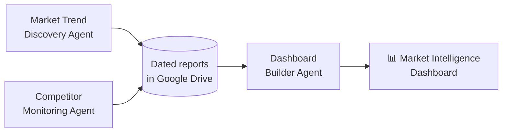

# 📊 Market Intelligence Dashboard
### From prototype to working dashboard: the executive view of the Wayfair Agentic BI pipeline

**Role:** Technical Product Manager and builder · **Frameworks:** CIRCLES · North Star metric

[← Back to project overview](../README.md)

> *Externship project using Wayfair as the business case. Not affiliated with or endorsed by Wayfair.*

---

## Contents
[Purpose](#purpose) · [Users](#users) · [Where It Fits](#where-it-fits) · [The Prototype](#the-prototype) · [The Working Dashboard](#the-working-dashboard) · [Sample Output](#sample-output-area-rugs) · [Design Decisions](#design-decisions) · [Product Framing](#product-framing-circles) · [Success Metric](#success-metric) · [Next Steps](#next-steps)

---

## Purpose

Category managers and executives shouldn't have to piece together separate trend, competitor, and content reports. The **Market Intelligence Dashboard** is the final step of the pipeline: one decision-ready view that answers three questions:

1. **What's trending** in my category?
2. **How do we compare** with competitors on price and assortment?
3. **What should we do next?**

---

## Users

| User | What they need from the dashboard |
|---|---|
| **Category Manager** (primary) | Which trends to stock, and where competitors leave gaps |
| **Inventory Planner** | Confidence that a trend is real before committing to stock |
| **Pricing Analyst** | Where Wayfair's prices sit against Amazon and Walmart |
| **Leadership** | A one-glance health check and the top recommended actions |

---

## Where It Fits

The trend and competitor agents save their reports to dated Google Drive folders. The Dashboard Builder agent picks up the latest of each, extracts the key data, and fills in the dashboard. See [Lab 05](https://github.com/LashawnFofung/Agentic-Workflow-Hub/blob/main/Labs/Lab%2005%20Final%20AI%20Agent.md) for how it was built.

---

## The Prototype

Before building, I prototyped the dashboard in **Base44** to test the layout and information hierarchy with a clickable UI.

🎥 **[Watch the prototype walkthrough](https://youtu.be/7shTzdWxmfE)**

**What the prototype explores:**
- Which insights belong "above the fold" for a busy executive
- How to group trend, competitor, and action content so it's scannable
- Whether recommended actions are clear enough to act on

---

## The Working Dashboard

The final dashboard, generated automatically by the n8n pipeline, organizes each category report into six sections:

| Section | What it shows |
|---|---|
| 📊 **Executive Overview** | Category health at a glance, key trend and competitive insights, suppliers to watch, alerts, and top actions |
| 📈 **Market & Trends** | Market size and growth, trending micro-segments, and dominant color palettes |
| ⚔️ **Competitive Intel** | Price and assortment comparison across Wayfair, Amazon, and Walmart |
| 🎯 **Opportunity Radar** | Gaps where competitors aren't meeting demand |
| ⚠️ **Risk & Diagnostics** | Market risks and data-quality notes |
| ✅ **Action Center** | Prioritized recommendations |

**Built-in features:** search, PDF export, a report date and product count for every run, and an **analysis scope note** that states how many products the insights are based on.

📄 [View the sample dashboard (HTML)](https://github.com/LashawnFofung/Agentic-Workflow-Hub/blob/main/Lab%20Artifacts/Lab%205/Area_Rug_Dashboard_2026-05-08.html) · 🧩 [Dashboard Builder workflow (JSON)](https://github.com/LashawnFofung/Agentic-Workflow-Hub/blob/main/N8N%20Workflow/Final%20Deliverables/Dashboard%20Builder%20Agent.json)

---

## Sample Output: Area Rugs

*From the dashboard generated on May 8, 2026.*

| | |
|---|---|
| **Scope** | 56 products sampled: 48 Wayfair, 7 Amazon, 1 Walmart |
| **Target segment** | Organic Modern Sculptural (premium): soft, rounded, nature-inspired rugs in light beige, warm sand, and cream |
| **Key trend** | "Sculptural softness": shoppers moving from purely functional rugs to textured, 3D, architectural pieces |
| **Key competitive insight** | Wayfair leads the mid-to-high, design-focused segment; Amazon and Walmart compete mainly on low-priced, functional rugs |
| **Wayfair average price** | $305 (premium position) |
| **Top actions** | Launch a "Utility-Plus" collection to compete with Amazon · set a price anchor in the $49–$59 range |

**Other trending micro-segments:** Global Boho Eclectic (mid-range) and Textured Neutral Layered (mid-range).

**Note:** market size and growth figures in the dashboard come from external sources gathered by the trend agent, and competitor insights reflect a small product sample. The dashboard states this scope on every report so decisions aren't made on more confidence than the data supports.

---

## Design Decisions

| Decision | Why |
|---|---|
| **Lead with actions, not charts** | Executives need "what to do next" first; the details sit one click away |
| **Show the analysis scope on every report** | A 56-product sample shouldn't be read as the full market |
| **One dashboard per category and date** | Keeps reports comparable over time and easy to find in Drive |
| **Generate it automatically** | The dashboard updates whenever the upstream agents run, with no manual assembly |
| **Fallback text for missing data** | One failed scrape shouldn't break the whole dashboard |
| **Render color names as real swatches** | Merchandisers think visually; a swatch communicates faster than a word |

---

## Product Framing (CIRCLES)

| Step | Decision |
|---|---|
| **Comprehend** | Sales data lags social trends by months, so inventory opportunities are missed. |
| **Identify** | Primary user: Inventory Planners and Category Managers. Secondary: Pricing Analysts. |
| **Report needs** | Clean data and confidence scores to justify stocking decisions. |
| **Cut** | Prioritized reliable data collection over visual polish. |
| **List** | Modular n8n agents for trends, competitors, and content, feeding one dashboard. |
| **Evaluate** | A faster model for high-volume classification; a stronger model for reasoning and synthesis. |
| **Summarize** | Deliver one unified dashboard with recommended actions. |

---

## Success Metric

**North Star: Time-to-Insight** — the time from "we have a question about a category" to "we have a decision-ready answer."

| | Estimate |
|---|---|
| **Before** (manual research, competitor checks, and report building) | ~15 hours |
| **After** (automated pipeline run) | ~1 minute |

*The "before" figure is an estimate for a manual process, not a measured baseline. The next step would be to time real users doing the task both ways.*

**Supporting metrics to track in a pilot:** weekly dashboard use by category managers, the share of recommended actions acted on, and stock decisions made earlier than with sales data alone.

---

## Next Steps

1. **Pilot with real users** to measure Time-to-Insight and which sections they use.
2. **Expand the data sample** beyond a few dozen products per retailer.
3. **Use licensed data feeds** in place of web scraping for reliability and compliance.
4. **Track trends over time** by comparing dashboards across dates.
5. **Publish the dashboard with GitHub Pages** so it can be viewed live.

---

**Related:** [Project overview](../README.md) · [PRDs](../Product%20Requirement%20Document%20%28PRD%29) · [Agentic Workflow Hub (the build)](https://github.com/LashawnFofung/Agentic-Workflow-Hub)
