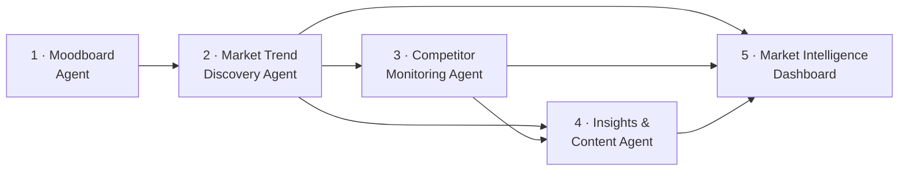

# 🛋️ Wayfair Agentic BI
### Product requirements, case study, and prototype for a 5-agent market-intelligence pipeline

**AI Product Management** · 8-week technical externship · Mar 2026 – May 2026

> *Externship project using Wayfair as the business case. Not affiliated with or endorsed by Wayfair.*

---

## Contents
[TL;DR](#tldr) · [The Problem](#the-problem) · [The Pipeline](#the-pipeline) · [Users](#users) · [Product Framing](#product-framing-circles) · [Success Metrics](#success-metrics) · [Spec vs. Build](#spec-vs-build) · [Artifacts](#artifacts) · [My Role](#my-role)

---

## TL;DR

| | |
|---|---|
| **Problem** | Wayfair's merchandising, pricing, and marketing teams rely on slow, manual research. Trends and competitor moves are spotted weeks late. |
| **Solution** | A five-agent pipeline: Moodboard → Trend Discovery → Competitor Monitoring → Insights & Content → Market Intelligence Dashboard |
| **PM artifacts** | 4 PRDs, a CIRCLES case study, personas and journey maps, a clickable dashboard prototype, and demo videos |
| **North Star** | **Time-to-Insight:** from ~15 hours of manual work (estimated) to about 1 minute of automated runtime |
| **Built, too** | I also built every agent in n8n. Workflows and outputs are in the companion **[Agentic Workflow Hub](https://github.com/LashawnFofung/Agentic-Workflow-Hub)**. |

---

## The Problem

| Team | Pain today | Why it matters |
|---|---|---|
| **Creative** | Seasonal moodboards take **15+ hours** of manual image sourcing | Slow campaign kickoff and inconsistent brand look |
| **Merchandising** | Sales data shows trends **4–6 weeks** after they start | Trending styles are under-stocked; fading ones are over-stocked |
| **Pricing** | Competitors change prices **daily**; teams audit **weekly** | Lost "Lowest Price" badges and missed out-of-stock openings |
| **Marketing** | Campaign briefs take about **5 business days** to draft | The trend window closes before the content ships |

**The core question:** How might we turn scattered market signals into decisions teams can act on the same day?

---

## The Pipeline

| # | Agent | What it does | Primary user | Spec | Build |
|---|---|---|---|---|---|
| 1 | **Moodboard** | Turns a style idea ("Modern Farmhouse") into moodboard images and a color palette | Creative Director | [PRD](Product%20Requirement%20Document%20%28PRD%29/PRD%20-%20Moodboard%20AI%20Agent.md) | [Lab 01](https://github.com/LashawnFofung/Agentic-Workflow-Hub/blob/main/Labs/Lab%2001%3A%20Moodboard%20Generator%20AI%20Agent.md) |
| 2 | **Market Trend Discovery** | Scores emerging "Hero" products from social, blog, and retail signals; labels each trend Niche or Saturated | Inventory Planner | [PRD](Product%20Requirement%20Document%20%28PRD%29/PRD%20-%20Market%20Trend%20Discovery%20AI%20Agent.md) | [Lab 02](https://github.com/LashawnFofung/Agentic-Workflow-Hub/blob/main/Labs/Lab%2002%20Discovery%20AI%20Agent.md) |
| 3 | **Competitor Monitoring** | Compares prices and stock across retailers and recommends **Match / Beat / Pivot** | Pricing Analyst | [PRD](Product%20Requirement%20Document%20%28PRD%29/PRD%20-%20Competitor%20Monitoring%20AI%20Agent.md) | [Lab 03](https://github.com/LashawnFofung/Agentic-Workflow-Hub/blob/main/Labs/Lab%2003%20Competitor%20Monitoring%20AI%20Agent.md) |
| 4 | **Insights & Content** | Turns trend and competitor reports into on-brand copy and design direction, with an "anti-AI-ism" tone filter | Content Strategist | [PRD](Product%20Requirement%20Document%20%28PRD%29/PRD%20-%20Content%20Strategy%20AI%20Agent.md) | [Lab 04](https://github.com/LashawnFofung/Agentic-Workflow-Hub/blob/main/Labs/Lab%2004%20AI%20Insight%20and%20Content%20Agent.md) |
| 5 | **Market Intelligence Dashboard** | Merges the latest reports into one executive briefing | Category Manager, leadership | [Prototype](Prototype/Market%20Intelligence%20Dashboard.md) · [Case Study](PRD%20CASE%20STUDY/Wayfair%20Agentic%20AI%20BI%20PRD%20Case%20Study.pdf) | [Lab 05](https://github.com/LashawnFofung/Agentic-Workflow-Hub/blob/main/Labs/Lab%2005%20Final%20AI%20Agent.md) |

---

## Users

Each PRD defines personas, user stories, and a day-in-the-life narrative. The case study adds journey maps.

| Agent | Personas | Example user story |
|---|---|---|
| Moodboard | Creative Director · Social Media Manager · Interior Designer | *"As a Creative Director, I want to review the AI's prompts before images are generated, so I can keep creative control."* |
| Trend Discovery | Inventory Planner · Trend Researcher · SEO Specialist | *"As an Inventory Planner, I want a confidence score for materials like terracotta, so I can justify stock increases."* |
| Competitor Monitoring | Pricing Analyst · Category Manager · Technical Product Owner | *"As a Category Manager, I want alerts when a competitor goes out of stock, so I can promote our alternatives."* |
| Insights & Content | Content Strategist · Marketing Manager · Creative Director | *"As a Content Strategist, I want generic phrases like 'elevate your space' filtered out, so I don't waste time editing."* |

---

## Product Framing (CIRCLES)

| Step | Decision |
|---|---|
| **Comprehend** | Sales data lags social trends by months, so inventory opportunities are missed. |
| **Identify** | Primary user: Inventory Planners. Secondary: Pricing Analysts and Category Managers. |
| **Report needs** | Clean data and a quantified confidence score to justify high-stakes stock decisions. |
| **Cut** | Prioritized reliable scraping of complex product pages over UI polish. |
| **List** | Modular n8n workflows, one agent per job, feeding each other. |
| **Evaluate** | A faster model for high-volume classification; a stronger model for strategic reasoning. |
| **Summarize** | One unified dashboard that turns all agent outputs into same-day recommendations. |

---

## Success Metrics

**North Star — Time-to-Insight (TTI):** the time from "we have a question" to "we have a decision-ready answer."
- **Baseline (estimated):** ~900 minutes of manual research, scraping, and design
- **With agents:** ~1 minute of automated runtime

| Agent | Key targets from the PRD |
|---|---|
| Moodboard | 95%+ of boards delivered in under 60 seconds · 90%+ "on-point" stakeholder rating |
| Trend Discovery | 80% less manual research time · 95% signal relevance in spot audits · user satisfaction ≥ 4/5 |
| Competitor Monitoring | Price changes flagged in < 24 hours (from ~7 days) · 15% more "Lowest Price" badge coverage in 60 days · 0% schema breakage |
| Insights & Content | Copy drafted in < 3 minutes · 85%+ of copy needs no manual cleanup · 100% valid JSON output |

*These are proposed targets for a real rollout, not measured results.*

**Guardrails defined in the PRDs:** clear non-goals (e.g., no automatic price changes or publishing), edge-case handling (retries, partial failures, missing data), tracking plans, data-privacy rules, and retailer terms-of-service flagged as a legal risk.

---

## Spec vs. Build

Because I also built the agents, I can show where the MVP matched the spec and where it was scoped down. That gap is normal; knowing it is the PM's job.

| Area | PRD (v1 vision) | MVP as built | Why |
|---|---|---|---|
| **Moodboard output** | 4 images in a 2×2 grid, plus an extracted hex palette and export | One generated image per idea | Proved the prompt → image pipeline first; palette extraction is the next increment |
| **Trend analysis model** | Gemini for classification and scoring | Mistral cleans and classifies; Gemini synthesizes | Splitting the jobs improved reliability of structured output |
| **Dashboard surface** | Auto-updating Google Sheets | Responsive HTML dashboard assembled from reports saved in Google Drive | Richer layout (tabs, color swatches) without Sheets formatting limits |
| **Competitor coverage** | Amazon and Walmart | Wayfair baseline + Amazon + Walmart | Comparing against Wayfair's own listings made the gaps actionable |

---

## Artifacts

| Type | Link |
|---|---|
| 📄 PRDs | [Moodboard](Product%20Requirement%20Document%20%28PRD%29/PRD%20-%20Moodboard%20AI%20Agent.md) · [Market Trend Discovery](Product%20Requirement%20Document%20%28PRD%29/PRD%20-%20Market%20Trend%20Discovery%20AI%20Agent.md) · [Competitor Monitoring](Product%20Requirement%20Document%20%28PRD%29/PRD%20-%20Competitor%20Monitoring%20AI%20Agent.md) · [Insights & Content](Product%20Requirement%20Document%20%28PRD%29/PRD%20-%20Content%20Strategy%20AI%20Agent.md) |
| 📊 Case study | [PDF](PRD%20CASE%20STUDY/Wayfair%20Agentic%20AI%20BI%20PRD%20Case%20Study.pdf) · [Video](https://youtu.be/faxDVoOzObo) |
| 🖥️ Prototype | [Walkthrough video (Base44)](https://youtu.be/7shTzdWxmfE) · [Prototype notes](Prototype/Market%20Intelligence%20Dashboard.md) |
| 🎬 Final demo | [Externship project demo (Loom)](https://www.loom.com/share/1b0678d00d154691bb7c01cddcfaeb2a) |
| 🧩 Workflows | [Trend Discovery v2](https://github.com/LashawnFofung/Agentic-Workflow-Hub/blob/main/N8N%20Workflow/Final%20Deliverables/Market%20Trend%20Discovery%20v2.json) · [Competitor Monitoring v2](https://github.com/LashawnFofung/Agentic-Workflow-Hub/blob/main/N8N%20Workflow/Final%20Deliverables/Competitor%20Monitoring%20AI%20Agent%20v2.json) · [Dashboard Builder](https://github.com/LashawnFofung/Agentic-Workflow-Hub/blob/main/N8N%20Workflow/Final%20Deliverables/Dashboard%20Builder%20Agent.json) |
| 🧪 All labs & sample outputs | [Agentic Workflow Hub](https://github.com/LashawnFofung/Agentic-Workflow-Hub) |

---

## My Role

**Technical Product Manager and builder**

- **Product:** defined the problem, personas, user stories, non-goals, success metrics, and rollout phases for four agents, and framed the system with CIRCLES and a North Star metric.
- **Prototype:** designed the Market Intelligence Dashboard and recorded the walkthrough.
- **Build:** created all five agents in n8n (self-hosted on Docker) with Gemini, Mistral, Hugging Face FLUX, Cheerio, and the Google Drive API.
- **Delivery:** shipped the final demo, workflows, and sample reports.

**Tools:** n8n · Docker · Google Gemini · Mistral AI · Hugging Face FLUX · Cheerio · Google Drive API · Base44

---

**Lashawn Fofung** · Technical Product Manager · [LinkedIn](https://www.linkedin.com/in/lashawnfofung/) · [AI Portfolio](https://github.com/LashawnFofung/AI-Portfolio) · [MBA Portfolio](https://github.com/LashawnFofung/MBA-IT-Management-Portfolio)

*Externship project using Wayfair as the business case. Not affiliated with or endorsed by Wayfair.*

